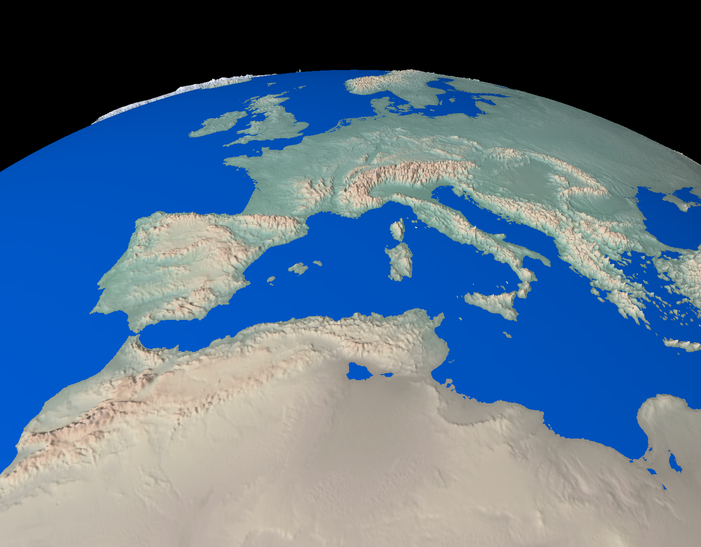

# Earth - 3D Map Renderer

A lightweight real-time 3D Earth renderer built in Rust using [wgpu](https://github.com/gfx-rs/wgpu). Primarily built as a learning project, with large parts of the implementation developed in collaboration with Gemini Flash 3.8 via Antigravity.



## Features

- **Cube-Sphere Mesh Generation**: Spherified cube topology (6 faces, subdivided into multiple mesh tiles) with compact 12-byte positions and zero UV overhead, avoiding polar pinch and antimeridian texture seams.
- **Two-Stage Culling**:
  - *Horizon Occlusion Culling*: Computes camera horizon tangency to discard terrain tiles on the back hemisphere (~40–65% geometry culled).
  - *Frustum Culling*: Bounding sphere checks against camera view frustum planes.
- **GPU Terrain Displacement & Precomputed 3D Normals**:
  - Displacement in WGSL vertex shaders driven by real-world GEBCO elevation data sampled directly from a native cubemap.
  - Precomputed 3D Sobel normals mapped across sphere curvature packed into RGBA8 cubemap DDS textures.
  - Dynamic water surface detection and shading.
- **Multi-Threaded Texture Pipeline**: Parallel Rayon downsampling that merges multi-gigabyte GeoTIFF tiles and projects them into optimized 6-face cubemap DDS textures with mipmaps in seconds.

---

## Controls

| Action | Control |
| :--- | :--- |
| **Pan / Rotate Globe** | Left-click + drag on Earth surface |
| **Orbit & Tilt (Heading/Pitch)** | Right-click, Middle-click, or `Shift`/`Ctrl` + Left-click + drag |
| **Zoom In / Out** | Scroll wheel or trackpad pinch |
| **Exit** | `Esc` |

---

## Getting Started

### 1. Download Source Textures

High-resolution source textures are not bundled in the repository:

1. **Diffuse Texture**: Download an equirectangular diffuse map from [Natural Earth](https://www.naturalearthdata.com/) and save it as:
   ```text
   res/in/diffuse.tif
   ```
2. **Elevation Data**: Download the 15 arc-second GeoTIFF grid (8 quadrant tiles) from [GEBCO](https://www.gebco.net/data-products/gridded-bathymetry-data) and place them in:
   ```text
   res/in/gebco_2026_geotiff/
   ```

### 2. Convert Textures to DDS

Run the offline converter to resample textures into 6-face cubemaps ($2048 \times 2048$ per face) and precompute 3D surface normals:

```bash
cargo run --release --bin convert_textures
```
*Generated textures are saved to `res/earth/diffuse_cube_2048x2048.dds` and `res/earth/elevation_cube_2048x2048.dds`.*

### 3. Run the Application

```bash
cargo run --release
```

---

## References

- Inspired by Sebastian Lague's [Earth Rendering video on YouTube](https://www.youtube.com/watch?v=sLqXFF8mlEU)
- Diffuse texture imagery from [Natural Earth](https://www.naturalearthdata.com/)
- Gridded elevation and bathymetry data from [GEBCO (2026 Grid)](https://www.gebco.net/data-products/gridded-bathymetry-data)
