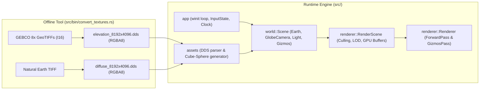

# Project Tour, Architecture Review & Improvement Guide

## 1. Project Tour & Architecture Analysis

The project is a self-contained real-time 3D Earth renderer written in Rust (~2,500 lines of Rust code across library and binaries, plus 2 WGSL shaders). It is split into two primary parts: an offline data-processing binary (`convert_textures`) and a real-time `winit` + `wgpu` rendering engine (`earth`).



### Module-by-Module Breakdown

#### 1. Offline Texture Pipeline (`src/bin/convert_textures.rs`)
* **Elevation & Normal Baking**: Reads 8 high-resolution 16-bit signed integer (`I16`) GeoTIFF tiles from the GEBCO 2026 bathymetry/elevation dataset (`res/in/gebco_2026_geotiff/`). Each quadrant tile is downsampled in parallel with `rayon` using bilinear interpolation into a global 8192 x 4096 elevation grid, clamping ocean depths (<= 0m) to `0.0`.
* **Spherical 3D Sobel Filter**: Rather than computing 2D tangent-space normals, the converter projects each pixel's (u, v) onto the unit sphere, displaces it radially by `1.0 + (elev / 8848.86) * 0.03`, and applies a 3 x 3 Sobel operator in 3D Cartesian space (`v_v.cross(v_u)`).
* **Channel Packing**: The resulting 3D unit normal is packed into `RGB` (`[0, 255]`), while normalized land elevation is packed into `Alpha` (`0` = water, `1..=255` = land elevation).
* **Custom Mipmap & DDS Writer**: Generates up to 8 mipmap levels (`compute_mip_count` clamps `ilog2` to `1..=8`). For the normal+elevation texture, each mip level unpacks the 4 parent normals, averages and re-normalizes the 3D vector, and averages the alpha channel. Finally, it writes raw uncompressed `RGBA8` bytes with a 128-byte DDS header to `res/earth/elevation_8192x4096.dds` and `res/earth/diffuse_8192x4096.dds`.

#### 2. Application Lifecycle & Input (`src/app/`)
* **`app_handler.rs`**: Implements winit's `ApplicationHandler` trait on `App`. Initializes the window and blocks on `State::new(window)` using `pollster::block_on` inside `resumed()`.
* **`state.rs`**: Holds the top-level runtime state: `Window`, `GpuContext`, `SurfaceHandler`, `Renderer`, `Scene` (logical world state), and `RenderScene` (GPU-mirrored state). Every `RedrawRequested` event ticks `Clock` and `FramerateLogger`, updates `Scene`, synchronizes `RenderScene`, submits the GPU frame via `Renderer::render`, and requests the next redraw.
* **`input.rs`**: Tracks pressed keys (`HashSet<KeyCode>`), mouse buttons (`HashSet<MouseButton>`), modifier states, and per-frame deltas (`cursor_delta`, `wheel_delta`, `pinch_delta`), which are reset at the end of each frame via `clear_frame_deltas()`.

#### 3. Geometry & Asset Loading (`src/assets/`, `src/geo/`)
* **`earth.rs`**: `Earth::load` uses nested `rayon::join` calls to concurrently parse the elevation DDS, parse the diffuse DDS, and generate the globe's cube-sphere meshes.
* **Spherified Cube Topology**: The unit cube's 6 faces (`CUBE_FACE_NORMALS`) are each subdivided into 4 x 4 patches (`96` meshes in total). Each patch is a 257 x 257 vertex grid (`resolution = 256 + 1`). Grid points on the cube `[-1, 1]^3` are mapped onto the unit sphere using Nowell's analytical spherification formula (`to_sphere_point`), avoiding the polar pinch of UV spheres and the diagonal distortion of normalized cubes.
* **Discrete Index Buffer LODs**: Each patch generates 4 levels of detail (`step` sizes `1, 2, 4, 8` in `generate_lod_indices`), concatenating all 4 index lists into a single `Vec<u32>` and recording `lod_ranges: Vec<Range<u32>>`.
* **`dds.rs` & `loader.rs`**: Reads DDS files from the build script's `OUT_DIR/res` folder, validates the 128-byte `DdsHeader` (and optional 20-byte `DX10` header), swizzles `BGRA` to `RGBA` in parallel if needed, and splits the payload into mip level buffers.
* **`culling.rs` & `latlng.rs`**: Provides coordinate conversions between 3D Cartesian unit vectors, spherical `LatLng` (radians), and equirectangular `UV` coordinates, alongside `BoundingSphere`, Gribb-Hartmann `Frustum` plane extraction, and `HorizonOccluder`.

#### 4. World State & Camera System (`src/world/`)
* **`globe_camera.rs`**: Parameterizes the camera in geographic coordinates relative to the unit sphere: `target: LatLng`, `distance` (0.015 to 10.0), `pitch` (0 deg to 80 deg), and `heading`. Constructs a local East-North-Up (`local_enu_frame`) basis at `target` to compute Cartesian `eye`, `target`, and `up` vectors.
* **`camera_controller.rs`**: Implements interactive globe navigation:
  * *Surface-Pinned Great-Circle Dragging* (Left-click): Casts a screen ray against the unit sphere (falling back to silhouette projection if the ray misses the horizon) and rotates `target` by the quaternion between the previous and current hit points, keeping the grabbed surface point locked under the cursor.
  * *Anchor-Aware Zoom* (Wheel / Trackpad pinch): Scales `distance` exponentially and lerps `target` toward the cursor's ray-sphere hit point.
  * *Orbit & Tilt* (Right/Middle-click or Shift/Ctrl + Left-click) and *WASD/Arrow keys*.
* **`camera.rs`**: Standard perspective camera that dynamically adjusts `znear` (0.1 * altitude, clamped between 0.0001 and 0.5) and `zfar` in `update_clip_planes()` to preserve depth buffer precision at low altitudes.
* **`scene.rs`**: Owns the `Camera`, `CameraController`, `Light` (which orbits the Y-axis at 10 deg/s), `Earth`, and `Gizmos`.

#### 5. GPU Context & Renderer (`src/gpu/`, `src/renderer/`)
* **`gpu/`**: Wraps `wgpu::Instance`, `Adapter`, `Device`, `Queue`, `SurfaceConfiguration` (selecting sRGB format and `Mailbox` / `AutoVsync` / `Fifo` present mode), `Depth32Float` depth texture, and mipmapped 2D texture uploads.
* **`render_scene.rs`**: Bridges `world::Scene` and `wgpu`. Uploads `RenderModel` vertex/index buffers and textures on startup. Every frame in `RenderScene::update()`, it performs two-stage culling (`HorizonOccluder` followed by `Frustum::contains_sphere`) across the 96 patches, selects an LOD (`0..=3`) based on closest distance to the patch's bounding sphere (`LOD_DISTANCE_THRESHOLDS = [0.2, 0.4, 1.0]`), updates camera/light uniform buffers, and updates the dynamic gizmo vertex buffer.
* **`forward.rs` & `forward.wgsl`**: Renders visible terrain patches.
  * *Vertex Shader (`vs_main`)*: Computes distance from camera to vertex, selects a mip level (`target_lod = t * 6.0`), samples `texture_elevation.a`, and displaces the vertex along its unit sphere normal (`unit_position * (1.0 + elevation * 0.03)`).
  * *Fragment Shader (`fs_main`)*: Samples diffuse color and mip `0` of the elevation/normal texture. Checks `elevation_sample.a <= 0.001` for water (overriding color to `(0.0, 0.1, 0.6)`), unpacks the 3D normal from `elevation_sample.rgb`, and computes Lambertian diffuse lighting plus Blinn-Phong specular sun glint on water.

---

## 2. Code Quality & Architecture Review

The overall architecture is clean and well-organized: separating pure state/math (`world`, `geo`, `assets`) from `wgpu` handles (`gpu`, `renderer`) keeps the codebase modular and easy to follow. However, a thorough line-by-line review reveals several bugs, dead code paths, and build issues.

### Bugs & Correctness Issues

1. **Antimeridian (+/-180 deg Longitude) UV Seam Artifact (`src/assets/earth.rs:102`, `src/geo/latlng.rs:15-19`)**
   * Equirectangular UV coordinates are computed per vertex on the CPU using `atan2(x, -z)` and stored in `Vertex::tex_coords`.
   * On the 4 cube faces that touch or cross the antimeridian (longitude = +/-pi, where `x = 0` and `z > 0`), `atan2(0.0, -z)` returns +pi (`u = 0.0`), whereas vertices immediately to the west (`x < 0`) have longitude tending to -pi (`u -> 1.0`).
   * For triangles touching `x = 0` (and for coarser LODs with `step = 2, 4, 8` that straddle across `x = 0`), the rasterizer linearly interpolates `u` backward across the entire texture from 1.0 down to 0.0 over a single triangle! Furthermore, screen-space UV derivatives (`dpdx`/`dpdy`) spike across that seam, causing the GPU to select the lowest mipmap level along the 180 deg meridian.

2. **Conservative Bounding Sphere Margin Underestimates Vertex Displacement (`src/renderer/render_model.rs:98-102`)**
   * `BoundingSphere::from_points` computes the centroid and radius of a patch's undisplaced vertices. For a 1/4 cube face patch, `bounding_sphere.radius` is roughly 0.20.
   * Line 102 applies `bounding_sphere.radius *= 1.05`, which only expands the radius by +0.01 world units.
   * However, `forward.wgsl` displaces vertices radially outward from the **planet center** (0, 0, 0) by up to `height_scale = 0.03` world units—which shifts the entire patch outward by 0.03, three times the +0.01 margin added to the local bounding sphere. High mountains near the edge of the screen can be prematurely frustum-culled.
   * **Fix**: Increase the radius by the maximum displacement (`bounding_sphere.radius += 0.035`), or compute the bounding sphere from the minimum and maximum displaced radii.

3. **Broken Wireframe Gizmos (`src/world/gizmos.rs:28-36`, `src/world/scene.rs:70-74`)**
   * Holding `Space` calls `Gizmos::add_model(&self.earth.model, white)` every frame, which has four compounding issues:
     1. `mesh.indices` contains **all 4 LOD index buffers concatenated together** (`src/assets/earth.rs:111-118`), so `add_model` iterates through all 4 LODs simultaneously on every mesh.
     2. Inside the loop (`for triangle in mesh.indices.as_chunks::<3>().0`), it only adds a single line `a -> b` (`triangle[0]` to `triangle[1]`), omitting the other two edges of each triangle (`b -> c` and `c -> a`).
     3. It uses the undisplaced unit-sphere vertex positions (`mesh.vertices[..].position`), so the wireframe renders *underneath* any displaced land/mountains (the `clip.z -= 0.0001 * clip.w` bias in `gizmos.wgsl` is much smaller than the 0.03 mountain displacement).
     4. It rebuilds and uploads ~3.4 million `GizmosVertex` structs (~96 MB/frame) to the GPU every single frame `Space` is held, tanking the framerate.

4. **Horizon Culling Constant Hardcoding (`src/geo/culling.rs:147`, `src/renderer/render_scene.rs:107, 146`)**
   * `HorizonOccluder` is constructed with `radius = 0.998` in `render_scene.rs`, while `is_sphere_behind_horizon` hardcodes `let max_terrain_radius = 1.035f32;` inside a general-purpose `HorizonOccluder` struct in `src/geo/culling.rs`. If `HorizonOccluder` is meant to be reusable, `max_occluded_radius` (or `max_terrain_radius`) should be a field on `HorizonOccluder` rather than a magic constant hidden inside the method.

### Build System, Dependencies & Dead Code

1. **`build.rs` Copies ~180 MB of DDS Textures into `target/` (`build.rs`, `src/assets/loader.rs`)**
   * `build.rs` copies `res/earth/*` into `target/<profile>/build/earth-.../out/res`, and `loader.rs` reads files from `env!("OUT_DIR")` at runtime.
   * **Problems**:
     * Duplicates ~180 MB of binary assets inside `target/` for every build profile.
     * Bakes an absolute compile-time path (`env!("OUT_DIR")`) into the binary, meaning the compiled executable cannot be moved to another machine or run if `target/` is cleaned.
     * The glob in `println!("cargo:rerun-if-changed=res/earth/*");` is not supported by Cargo (`rerun-if-changed` takes a file or directory path `res/earth`, not a `*` glob).
   * **Fix**: Delete `build.rs` and the `fs_extra` dependency entirely, and load from `"res"` relative to the working directory (or executable directory).

2. **Unused Dependencies & Unnecessary GPU Features (`Cargo.toml`, `src/gpu/context.rs`)**
   * `tobj` and `futures` in `Cargo.toml` are completely unused remnants from an earlier tutorial template.
   * `GpuContext::new` (`src/gpu/context.rs:32`) requires `wgpu::Features::TEXTURE_FORMAT_16BIT_NORM` with the comment `// used for elevation sampling`, even though the elevation texture uses `TextureFormat::Rgba8Unorm`. Requiring `TEXTURE_FORMAT_16BIT_NORM` unnecessarily prevents running on WebGPU or hardware without 16-bit norm support.

3. **Duplicated DDS Structs & Constants (`src/assets/dds.rs` vs `src/bin/convert_textures.rs`)**
   * `DdsPixelFormat`, `DdsHeader`, and the `DDS_*` bitflags are duplicated verbatim across `src/assets/dds.rs` and `src/bin/convert_textures.rs`. Expose or share the module from the library crate instead.

4. **Dead Fields & Redundant Vertex Data**
   * `GlobeCamera` (`src/world/globe_camera.rs:21-24`) declares `vel_target`, `vel_distance`, `vel_heading`, and `vel_pitch` ("Dynamic velocities for smooth inertia"), which are never read or used anywhere in `CameraController`.
   * `Vertex::normal` (`src/assets/model.rs:54`) is identical to `Vertex::position` on the unit sphere, takes up 12 bytes per vertex (37.5% of the vertex buffer), is bound at `@location(2)` in `forward.wgsl`, and is **never used** in the shader.
   * `Clock::frame_count` (`src/app/time.rs:5`) is incremented every frame and never read.
   * `Earth::load` and `Scene::load` are marked `async` even though `Earth::load` performs only synchronous `rayon::join` work and contains no `.await` points.

5. **Outdated README Instructions (`README.md:54`)**
   * `README.md` states that `convert_textures` saves `res/earth/diffuse.dds` and `res/earth/elevation.dds`, whereas it actually outputs `diffuse_8192x4096.dds` and `elevation_8192x4096.dds`.

---

## 3. Making It More Idiomatic Rust

1. **Avoid Massive Memory Copies in `parse_dds` (`src/assets/dds.rs:118-135`)**
   Currently, `parse_dds(mut data: Vec<u8>)` does:
   ```rust
   data.drain(0..header_size); // Memmoves ~90 MB of pixel data left by 128 bytes!
   ...
   for &level_len in &mip_sizes[..mip_sizes.len().saturating_sub(1)] {
       let next = remaining.split_off(level_len); // Allocates and copies all remaining mip levels on every iteration!
       mip_levels.push(remaining);
       remaining = next;
   }
   ```
   * **Idiomatic / Zero-Copy Fix**: Keep `data: Vec<u8>` intact in `ImageAsset` along with `mip_offsets: Vec<Range<usize>>`, and pass `&data[range.clone()]` slices to `Texture::create_2d`. That eliminates 100% of heap reallocations and `memmove`s during DDS loading.

2. **Replace `assert!` with `anyhow::ensure!` (`src/assets/earth.rs:23-24`)**
   Lines 23–24 have a comment `// TODO return an error instead`:
   ```rust
   anyhow::ensure!(resolution >= 2, "resolution must be at least 2");
   anyhow::ensure!(subdivisions >= 1, "subdivisions must be at least 1");
   ```

3. **Deduplicate `RenderScene::new` and `RenderScene::update` (`src/renderer/render_scene.rs:106-168`)**
   `RenderScene::new` duplicates the exact 25-line frustum/horizon culling and LOD selection loop from `RenderScene::update`. Initialize `RenderScene` with `visible_earth_meshes: Vec::with_capacity(render_earth.meshes.len())` and call `scene_renderer.update(device, queue, scene)` at the end of `new()`.

4. **Use `wgpu::vertex_attr_array!` or `std::mem::offset_of!` (`src/renderer/render_model.rs:125-147`)**
   Instead of manual `mem::size_of::<[f32; 5]>() as BufferAddress` pointer arithmetic in `Vertex::desc()` and `GizmosVertex::desc()`, use `wgpu::vertex_attr_array!` or Rust 2024's standard `std::mem::offset_of!(Vertex, normal)`.

5. **Consistent Logging (`log` vs `println!`)**
   `env_logger::init()` is called at startup in `src/app.rs`, and `log::error!` is used in `app_handler.rs`, but `State::new` and `FramerateLogger` use `println!`. Switching to `log::info!` / `log::debug!` respects `RUST_LOG` filtering.

---

## 4. Rendering & Performance Improvements

### A. GPU Performance & Memory Optimizations

1. **Share a Single Index Buffer Across All 96 Patches (`src/assets/earth.rs`, `src/renderer/render_model.rs`)**
   * Every one of the 96 patches (`create_face_part`) has the **exact same grid resolution (257 x 257) and triangle index topology**, yet `create_face_part` generates 96 identical `Vec<u32>` index arrays (~524,000 indices each) and `RenderModel::from_model` uploads **96 separate GPU index buffers** (~200 MB of duplicate index data!).
   * Creating a **single shared index buffer** (and binding it once before the loop in `ForwardPass::draw`) immediately saves ~200 MB of RAM/VRAM, speeds up startup mesh generation, and removes 95 redundant `set_index_buffer` calls per frame.

2. **Drop Unused `Vertex::normal` (and Optionally `tex_coords`) (`src/assets/model.rs`)**
   * Removing the unused `normal: [f32; 3]` field shrinks `Vertex` from 32 bytes to 20 bytes (**37.5% less vertex memory and bandwidth**).
   * Even better: since every vertex lies on the unit sphere (`position` *is* the unit sphere normal), if you compute equirectangular UV in the shader (or use a cubemap), `Vertex` only needs `position: [f32; 3]` (12 bytes—a **62.5% reduction**).

3. **Hardware Wireframe Pipeline (`PolygonMode::Line`) Instead of CPU `Gizmos`**
   * If the goal of pressing `Space` is to inspect the globe's mesh topology and LOD transitions, create a second `RenderPipeline` in `ForwardPass` with `polygon_mode: PolygonMode::Line` (or render a wireframe overlay in the fragment shader using barycentric coordinates / screen-space derivatives `fwidth`).
   * This automatically reflects only the **currently visible patches**, their **active LOD level (0..=3)**, and their **GPU vertex shader terrain displacement**, with **zero CPU overhead**.

4. **Eliminate LOD Seam Cracks via Terrain Skirts (`src/assets/earth.rs`)**
   * When an LOD 0 patch (`step = 1`) borders an LOD 1 patch (`step = 2`), T-junctions along the shared boundary lie at different sphere heights and sample different elevation texels, causing visible cracks/holes between patches.
   * **Fix**: Add a short vertical "skirt" around the 4 outer edges of each patch (duplicating boundary vertices pushed slightly inward toward the sphere center, e.g. `radius * 0.99`), or stitch edge indices to match neighbor LODs.

5. **Block-Compressed DDS Textures (`BC1` / `BC7`)**
   * Currently both 8192 x 4096 DDS textures are uncompressed `RGBA8` (~90 MB each in VRAM). Compressing the diffuse texture to `BC1` or `BC7` (`TextureFormat::Bc1RgbaUnormSrgb` / `Bc7RgbaUnormSrgb`) cuts diffuse VRAM usage and GPU memory bandwidth by **4x to 8x** and allows scaling up to 16384 x 8192 textures within the same memory footprint.

### B. Visual Quality & Shader Upgrades (`src/renderer/forward.wgsl`)

1. **Enable Mipmapped Normal Sampling & Anisotropic Filtering (`src/renderer/forward.wgsl:68`, `src/gpu/texture.rs:17`)**
   * In `forward.wgsl:68`, the fragment shader hardcodes mip level `0.0`:
     ```wgsl
     let elevation_sample = textureSampleLevel(texture_elevation, sampler_elevation, vertex.tex_coords, 0.0);
     ```
     Because it forces mip `0.0` at all camera distances, viewing the globe from space severely undersamples the 8192 x 4096 normal map, causing **normal aliasing / shimmering** on mountain ranges and completely ignoring the 7 lower mip levels that `convert_textures.rs` carefully precomputed!
   * Furthermore, `Texture::create_sampler` leaves `anisotropy_clamp` at `1`. Setting `anisotropy_clamp: 16` in `SamplerDescriptor` and switching line 68 to `textureSample(texture_elevation, sampler_elevation, vertex.tex_coords)` makes oblique horizon views dramatically sharper and eliminates normal shimmering.

2. **Fix the Antimeridian UV Seam in the Shader (`src/renderer/forward.wgsl`)**
   * Instead of interpolating `tex_coords.x` across vertices that wrap from 1.0 -> 0.0 at the +/-180 deg meridian, pass the 3D `unit_position` to the fragment shader and compute `uv` per-pixel using `atan2` paired with `textureSampleGrad` (using continuous 3D position derivatives `dpdx(unit_position)` / `dpdy(unit_position)` so mipmap selection never spikes at the seam), **or** convert the equirectangular texture into a **6-face Cubemap (`texture_cube<f32>`)** in `convert_textures.rs`! A cubemap completely eliminates equirectangular polar stretching, UV seams, and `atan2` trigonometry.

3. **Smooth Coastlines & Keep Natural Bathymetry Colors (`src/renderer/forward.wgsl:70-74`)**
   * Currently, water is detected via a hard binary threshold that overwrites the diffuse texture with a flat blue:
     ```wgsl
     let is_water = elevation_sample.a <= 0.001;
     if (is_water) {
         object_color = vec4<f32>(0.0, 0.1, 0.6, 1.0);
     }
     ```
     This creates jagged, pixelated coastlines when zoomed in and discards the coastal/bathymetric shading present in the Natural Earth diffuse map.
   * **Fix**: Use a smooth coastline transition (`let water_factor = 1.0 - smoothstep(0.0, 0.004, elevation_sample.a);`) and blend the Natural Earth texture color with a deep-ocean Fresnel tint rather than replacing it with a solid flat RGB value.

4. **Atmospheric Fresnel Rim Glow & Twilight Terminator (`src/renderer/forward.wgsl`)**
   * Adding a subtle Rayleigh-inspired atmospheric rim light (`pow(1.0 - max(dot(sphere_normal, view_dir), 0.0), 4.0)`) modulated by sunlight direction, along with a warm orange/red scatter band across the day-night terminator (`smoothstep(-0.1, 0.2, dot(sphere_normal, light_dir))`), takes ~10 lines of WGSL and dramatically improves the realism of the planet from orbit.

5. **Implement the Inertial Camera Damping (`src/world/globe_camera.rs`, `src/world/camera_controller.rs`)**
   * Wire up the already-declared `vel_target`, `vel_distance`, `vel_heading`, and `vel_pitch` fields in `GlobeCamera` with exponential decay (`vel *= (-damping * dt).exp()`) so panning, orbiting, and zooming glide smoothly to a stop after releasing the mouse.

---

## 5. Summary & Prioritized Roadmap

| Priority | Area | Recommendation | Impact |
| :--- | :--- | :--- | :--- |
| **P0 (High)** | **Shader & Visuals** | Use `textureSample` (with `anisotropy_clamp: 16`) instead of `textureSampleLevel(..., 0.0)` in `fs_main`; smooth the water mask; add atmospheric rim & terminator shading. | Eliminates normal shimmering, fixes blurry oblique terrain, major visual upgrade. |
| **P0 (High)** | **Geometry & UV Seam** | Fix the +/-180 deg antimeridian UV seam (via fragment UV + `textureSampleGrad` or a Cubemap texture) and add terrain skirts to hide inter-patch LOD cracks. | Fixes visible texture warping seam and geometry gaps between LODs. |
| **P1 (Med)** | **GPU Memory & Perf** | Share a single index buffer across all 96 patches; remove unused `Vertex::normal`; replace CPU `Gizmos::add_model` with a `PolygonMode::Line` pipeline. | Saves ~220 MB of buffers, eliminates 95 index buffer binds/frame, makes wireframe mode instant and accurate. |
| **P2 (Med)** | **Build & Asset Loading** | Remove `build.rs` (stop copying 180 MB into `target/`), make `parse_dds` zero-copy, remove unused `tobj`/`futures` dependencies and `TEXTURE_FORMAT_16BIT_NORM` requirement. | Faster builds, faster startup, portable binary, broader GPU compatibility. |
| **P3 (Low)** | **Rust Idioms & Polish** | Deduplicate `DdsHeader` and `RenderScene` culling loop, replace `assert!` with `anyhow::ensure!`, wire up `GlobeCamera` velocity inertia, fix `BoundingSphere` displacement margin. | Cleaner, more maintainable, idiomatic Rust code and smoother camera feel. |
